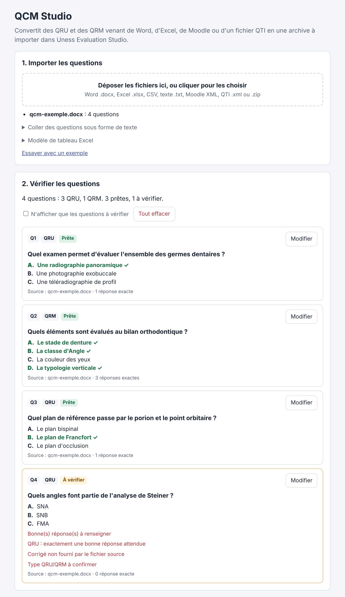

# QCM Studio

QCM Studio est une application web qui convertit des QRU et des QRM venant de Word, de Wooclap, d'Excel, de Moodle ou d'un fichier QTI en une archive à importer dans Uness Evaluation Studio (QTI au format SIDES).



## Contexte

Uness Evaluation Studio importe des questions au format QTI, mais les questions existent souvent ailleurs : dans un document Word, un tableau Excel, une banque Moodle ou un export Wooclap. Les ressaisir une à une dans le Studio prend du temps.

L'application lit ces fichiers, reconnaît les questions et leurs propositions, et reprend le corrigé quand il figure dans le fichier. Les questions dont le corrigé manque ou reste ambigu sont signalées et se corrigent dans la page. L'archive QTI n'est produite qu'une fois toutes les questions prêtes et peut être directement importée dans Uness Evaluation Studio.

## Utilisation

L'application tient dans un seul fichier, `index.html`. On peut l'ouvrir en ligne à l'adresse https://acavare.github.io/convertisseur-UNESS-QCM/, ou la télécharger (bouton « Code », puis « Download ZIP ») et ouvrir `index.html` d'un double-clic.

1. Déposez un ou plusieurs fichiers dans le cadre, ou collez les questions sous forme de texte. On peut aussi créer les questions directement dans la page avec « + Ajouter une question ».
2. Parcourez la liste. Une question marquée « À vérifier » n'a pas de corrigé exploitable : cliquez sur « Modifier », cochez les bonnes réponses, puis sur « Valider la question ». Si les erreurs signalées sont uniquement liées au barème de notation exporté depuis Moodle, il est possible de valider l'ensemble des questions avec le bouton "Tout accepter"
3. Une fois toutes les questions prêtes, indiquez le titre et l'identifiant de la banque, puis téléchargez l'archive QTI (.zip).
4. Dans Uness Evaluation Studio, cliquez sur « Import QTI » dans le menu de gauche, déposez l'archive, puis cliquez sur « Importer ». La fiche d'aide de l'UNESS [Comment réaliser un import QTI dans le Studio ?](https://assistance.uness.fr/pluginfile.php/276/mod_resource/content/1/Studio_import_QTI_202507.pdf) détaille la procédure.

## Écrire les questions

### Word ou texte

Une question commence par « QRU : » ou « QRM : », suivi de l'énoncé. Chaque proposition occupe sa propre ligne et commence par une lettre, de A à H, suivie de deux-points, d'une parenthèse ou d'un point. Un astérisque en fin de ligne désigne une bonne réponse :

```
QRU : Quel examen permet d'évaluer l'ensemble des germes dentaires ?
A : Une radiographie panoramique *
B : Une photographie exobuccale
C : Une téléradiographie de profil

QRM : Quels éléments sont évalués au bilan orthodontique ?
A : Le stade de denture *
B : La classe d'Angle *
C : La couleur des yeux
D : La typologie verticale *
```

D'autres façons d'écrire sont reconnues :

- « QCU » et « QCM » à la place de « QRU » et « QRM » ;
- une question simplement numérotée (« 1. », « 2) », « Question 3 : »), voire sans numéro si ses propositions la suivent directement. Le type est alors déduit du nombre de bonnes réponses ;
- des propositions écrites « A) », « a. » ou « A - », ou précédées d'un tiret ;
- le corrigé sur une ligne à part, sous les propositions : « Bonne réponse : B », « Bonnes réponses : A, C » ou « Réponses correctes : 1, 3 » ;
- une coche (✓) ou [x] à la place de l'astérisque.

Dans Word, les lettres des propositions doivent être tapées au clavier : la numérotation automatique et les puces de Word ne sont pas lues. Une ligne qui ne commence ni une question ni une proposition est rattachée à celle qui la précède. Le document ne doit donc contenir que les questions : un titre ou une consigne placés juste au-dessus d'une question risquent d'être pris pour une question, ou collés à son énoncé.

Le fichier [exemple/qcm-exemple.docx](exemple/qcm-exemple.docx) reprend ces écritures. Sa dernière question n'a pas de corrigé, pour voir comment l'application la signale.

### Excel ou CSV

Une ligne par question, sous une ligne d'en-têtes :

| Type | Question | A | B | C | D | Bonnes réponses |
|---|---|---|---|---|---|---|
| QRU | Quel cliché permet d'étudier le profil squelettique ? | Radiographie panoramique | Téléradiographie de profil | Cliché rétro-alvéolaire | | B |
| QRM | Quels angles font partie de l'analyse de Steiner ? | SNA | SNB | FMA | ANB | A, B, D |

- Les en-têtes peuvent varier : « Énoncé » ou « Intitulé » pour la question, « Choix A », « Proposition A » ou « Réponse 1 » pour les propositions, « Bonne réponse », « Réponses correctes » ou « Solution » pour le corrigé.
- Le corrigé s'écrit en lettres (« A, C ») ou en numéros (« 1, 3 »). Un astérisque à la fin d'une proposition convient aussi.
- La colonne « Type » est facultative : sans elle, le type est déduit du nombre de bonnes réponses.
- Toutes les feuilles du classeur sont lues. Un fichier CSV peut utiliser le point-virgule, la virgule ou la tabulation comme séparateur, et ses accents sont lus correctement, qu'il soit enregistré en UTF-8 ou par Excel sous Windows.

Le fichier [exemple/modele-qcm.xlsx](exemple/modele-qcm.xlsx) peut servir de point de départ.

### Moodle, QTI et Wooclap

- Moodle : fichier XML exporté depuis la banque de questions (format « Moodle XML »). Seules les questions à choix multiple sont reprises. Une réponse dotée d'un pourcentage positif compte comme bonne réponse.
- QTI : fichiers .xml au format QTI 1.2 ou 2.x, ou archive .zip qui les contient. Le corrigé est repris quand le fichier le déclare explicitement. Des points attribués aux propositions ne suffisent pas : une question qui n'a que des points reste à compléter.
- Wooclap : les exports Excel et QTI sont reconnus.

## Contrôles

Chaque question doit avoir un énoncé, entre deux et huit propositions non vides et au moins une bonne réponse. Une QRU en a exactement une. Quand le fichier ne donne pas de corrigé certain, la question reste « À vérifier » : l'application ne devine jamais une bonne réponse.

Les barèmes particuliers (pourcentages Moodle, pénalités, points QTI) ne passent pas dans l'archive : seules les bonnes réponses sont conservées. Les questions concernées sont signalées. Si leurs réponses cochées sont justes, le bouton « Tout accepter » les confirme en une fois.

## Export

Voici les éléments exportés: 
- L'archive QTI (.zip) : un fichier `QUESTION_n.xml` par question, au format QTI 2.1, et un fichier `pool.xml` qui les réunit avec le titre, l'identifiant et les consignes éventuelles.
- Le texte des questions (.txt), dans le format décrit plus haut.
- Un tableau de vérification (.csv) à ouvrir dans Excel : une ligne par question, avec le corrigé, le fichier d'origine et les points restant à vérifier.

## Limites

Seules les QRU et les QRM sont prises en charge, avec huit propositions au plus. Les images, les équations et la mise en forme ne sont pas reprises. Dans un fichier Word, les images sont ignorées. Dans un fichier Moodle ou QTI, une question qui en contient est écartée. Un avertissement le signale dans les deux cas. Les anciens fichiers .doc ne sont pas lus : il faut d'abord les enregistrer au format .docx.

## Confidentialité

Les fichiers sont lus dans le navigateur et ne sont envoyés nulle part sur internet. L'application ne charge aucune ressource extérieure.

## Compatibilité

Toute version de Chrome, Edge, Firefox ou Safari parue depuis 2023.

## Contenu du dépôt

- `index.html` : l'application, en un seul fichier et sans dépendance.
- `exemple/qcm-exemple.docx` : quelques questions fictives rédigées sous Word.
- `exemple/modele-qcm.xlsx` : un modèle de tableau Excel.
- `docs/apercu.png` : la capture d'écran ci-dessus.

## Mention légale

<sub>© 2026 Anaïs Cavaré. Code distribué sous licence MIT (voir le fichier LICENSE). Outil indépendant, sans lien avec l'UNESS ; Uness Evaluation Studio est un service de l'UNESS. Fourni sans garantie : vérifiez toujours les questions et leur corrigé dans le Studio avant de les utiliser pour une épreuve. Développé avec l'aide de Claude (Anthropic) modèle Opus 5.5.</sub>
